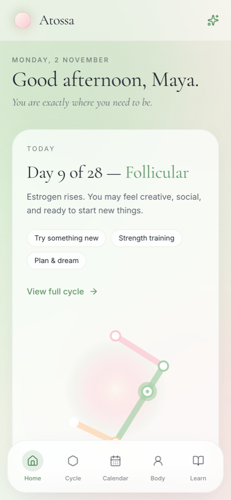
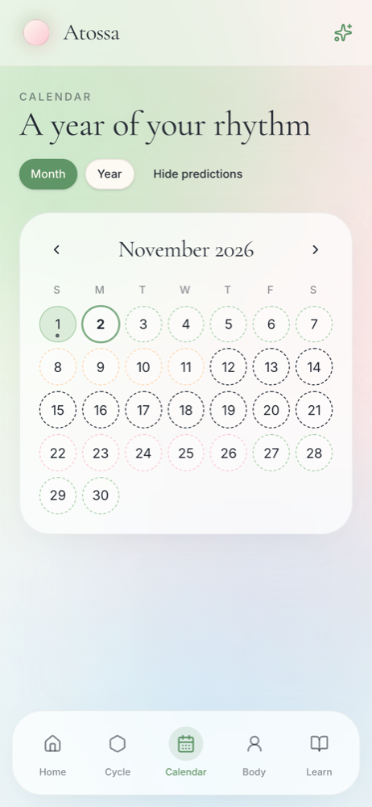
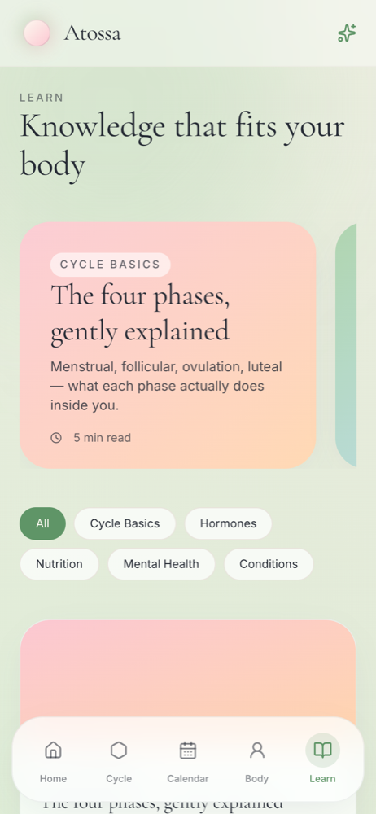
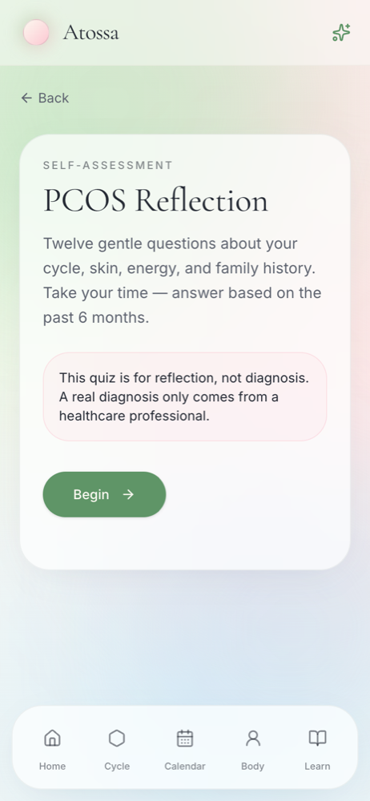

# Atossa

A private menstrual cycle and wellness web app. Atossa models a cycle as a shape, logs symptoms by day and by body region, and keeps all of that data on the user's own device.

Prototyped in [Lovable](https://lovable.dev), then reviewed and verified to build and run independently of it. See [Running without Lovable](#running-without-lovable).

    

| Home | Calendar | Learn | Self-assessment |
| :--: | :------: | :---: | :-------------: |
|  |  |  |  |

<sub>Screenshots use made-up data. The open polygon on Home and the dark rings on the Calendar are the first [known issue](#known-issues).</sub>

## Features

- **Polygon cycle view:** an SVG shape with one side per phase (2 to 6), each drawn in proportion to that phase's length, with a marker for today. Phases can be renamed, recoloured, resized, added and removed, and the shape updates live.
- **Calendar:** month and year views, predictions up to 12 cycles ahead, and a daily log for flow, mood, symptoms and notes.
- **3D body map:** a React Three Fiber scene that can be rotated and zoomed. Tapping a region logs a sensation with a 0 to 10 pain score.
- **Learn:** in-app articles grouped by category, plus links to outside resources.
- **PCOS and endometriosis reflections:** weighted 12-question self-assessments, labelled as educational rather than diagnostic.
- **Installable:** a web app manifest and iOS home screen metadata. There is no service worker, so it does not work offline yet.

There is no account, and no backend database. App state lives in `localStorage` through a persisted Zustand store.

## Tech stack

| Area | Tools |
| :--- | :---- |
| Framework | React 19, TypeScript, TanStack Start (SSR), TanStack Router (file-based routes) |
| Build | Vite 7, Nitro (deploy output) |
| Styling | Tailwind CSS 4, shadcn/ui (Radix primitives), Framer Motion |
| 3D | Three.js, React Three Fiber, Drei |
| State | Zustand with `persist` |
| Dates | date-fns |
| Hosting target | Cloudflare Workers (`wrangler.jsonc`) |

## Getting started

Requires [Bun](https://bun.sh) and Node.js.

```bash
git clone https://github.com/ziba18/cycle-bloom.git
cd cycle-bloom
bun install --frozen-lockfile
bun run dev
```

Vite prints the local URL when it starts. No environment variables are needed.

> `bun.lockb` is the current lockfile. `package-lock.json` is out of date, so `npm ci` fails. If you need npm, use `npm install --legacy-peer-deps`, which also rewrites `package-lock.json`.

| Command | What it does |
| :------ | :----------- |
| `bun run dev` | Start the dev server |
| `bun run build` | Production build |
| `bun run preview` | Serve the production build locally |
| `bun run lint` | Run ESLint |
| `bun run format` | Format with Prettier |

## Project structure

```text
src/
├── routes/        File-based routes: home, cycle, calendar, body, learn, quizzes
├── components/
│   ├── body/      3D anatomy scene
│   ├── quiz/      Shared quiz flow
│   ├── ui/        shadcn/ui component library
│   ├── AppShell.tsx        Navigation and onboarding gate
│   ├── Onboarding.tsx      First-run setup
│   └── PolygonCycle.tsx    Signature SVG visualisation
├── data/          Article and quiz content
├── lib/cycle.ts   Cycle maths: day in cycle, phase lookup, next period, polygon geometry
├── store/         Zustand store and data types
└── styles.css     Design tokens and Tailwind theme
```

`src/routeTree.gen.ts` is generated by the router plugin. Don't edit it by hand.

## Running without Lovable

The app has no runtime dependency on Lovable: `src/` makes no Lovable calls and uses no Lovable APIs. The coupling is all in the build tooling.

| Dependency | Where | Effect outside Lovable |
| :--------- | :---- | :---------------------- |
| `@lovable.dev/vite-tanstack-config` | `vite.config.ts`, `package.json` | Wraps the whole Vite setup, and brings in `lovable-tagger`, a dev server bridge and an HMR gate |
| Nitro deploy step | Inside that config | Skipped unless a Lovable sandbox is detected, so a plain `vite build` passes but gives no deployable Cloudflare bundle |
| Lockfiles | `bun.lockb`, `package-lock.json` | Only the Bun lockfile is current |
| `.lovable/plan.md` | Repository root | Original build plan. Not used by the app |

### Option 1: keep the config and force a deploy target

```ts
// vite.config.ts
import { defineConfig } from "@lovable.dev/vite-tanstack-config";

export default defineConfig({ nitro: { preset: "cloudflare-module" } });
```

The build writes to `dist/`. Deploy with:

```bash
npx wrangler deploy --config dist/server/wrangler.json
```

### Option 2: remove Lovable completely

```bash
npm uninstall @lovable.dev/vite-tanstack-config --legacy-peer-deps
npm install -D nitro@3.0.260429-beta --legacy-peer-deps
```

```ts
// vite.config.ts
import { defineConfig } from "vite";
import { tanstackStart } from "@tanstack/react-start/plugin/vite";
import { nitro } from "nitro/vite";
import viteReact from "@vitejs/plugin-react";
import tailwindcss from "@tailwindcss/vite";
import tsConfigPaths from "vite-tsconfig-paths";

export default defineConfig({
  plugins: [
    tsConfigPaths(),
    tailwindcss(),
    tanstackStart(),
    nitro({ preset: process.env.NITRO_PRESET ?? "node-server" }),
    viteReact(),
  ],
});
```

This writes to `.output/`. Start it with `PORT=3000 node .output/server/index.mjs`. Set `NITRO_PRESET` to target another host.

### What was verified

| Check | Result |
| :---- | :----- |
| `bun install --frozen-lockfile` | Passes |
| `tsc --noEmit` | Passes |
| All routes in the dev server, with a seeded profile | Load with no console errors |
| Option 1, `cloudflare-module` preset | Build passes, `wrangler deploy --dry-run` passes. Not deployed to a live Worker |
| Option 1, `node-server` preset | Server returns 200 on the 4 routes tested |
| Option 2, Lovable removed, `node-server` preset | Build and `tsc` pass, server returns 200 on all 7 routes |

These were one-off checks. Options 1 and 2 are not applied in this repository. Nitro here is a pinned beta, so check for a stable release before relying on it.

## Known issues

- **The Luteal phase has no colour.** Tailwind 4 removes `--color-sky` and `--color-lavender` from the build because they are only referenced through strings built at runtime (`var(--color-${phase.color})`). The polygon's last side disappears, and any phase using those colours is affected. Referencing the raw `--sky` and `--lavender` tokens, or using `@theme static`, should fix it.
- **ESLint reports 246 problems.** 227 are auto-fixable Prettier formatting. The other 19 are 12 uses of `any` and 7 `react-refresh` warnings.
- **No automated tests.** `src/lib/cycle.ts` is pure logic and the natural place to start.
- **Unused UI code.** The app directly imports 6 of the 46 generated `ui/` components, and many Radix packages could go with the rest.
- **Leftover scaffold names.** `tanstack_start_ts` in `package.json`, `tanstack-start-app` in `wrangler.jsonc`, and `lunara-store-v1` as the storage key.

## Medical disclaimer

Atossa is an educational prototype, not a medical device. It does not diagnose any condition, and cycle predictions are simple estimates based on the phase lengths entered by the user. Anyone with health concerns should speak to a healthcare professional.

## Author

Built by [Ziba Zamani](https://github.com/ziba18).
